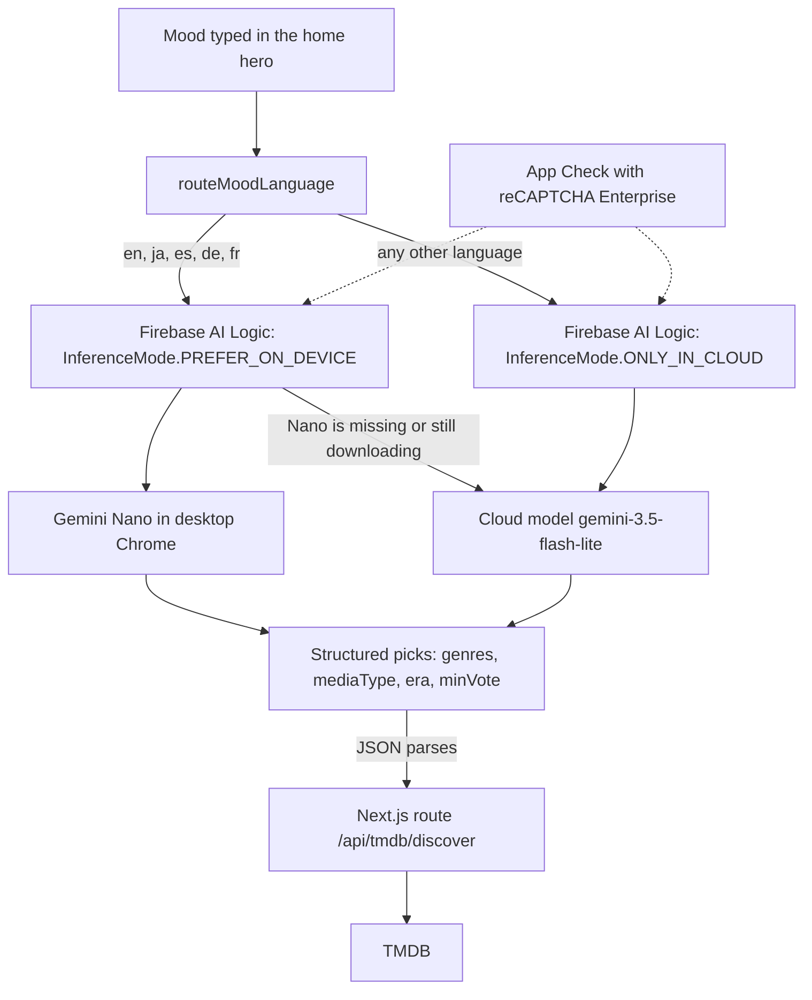

# Moodcut: tell it how you feel, get something worth watching.

Find films and shows by mood, with Gemini Nano running on your device and a cloud fallback when you need it.

> **TODO:** Add a short GIF here of a mood turning into a row of films. Suggested alt text: "A mood search on the Moodcut home page."

[](https://firebase.google.com/docs/ai-logic/hybrid/web/get-started)
[](https://firebase.google.com/docs/ai-logic/hybrid/web/get-started)
[](https://firebase.google.com/docs/ai-logic/hybrid/web/get-started)
[](LICENSE)

**Live demo:** TODO · **Demo video:** TODO · [How it works](#how-hybrid-inference-works)

## Judge quick check

Give this about a minute in desktop Chrome.

1. Open the live demo (TODO) or run the app locally and open [http://localhost:3000](http://localhost:3000).
2. The home page opens on the mood search. The headline reads **How do you feel tonight?** Type a short mood and press **Find films**, or choose a mood chip. From any page, open Search and choose **Search by mood** when the words read like a feeling. That route is `/mood?q=`, and it runs the same search on the home hero.
3. Watch the steps under the field. They follow the real work: reading the mood, thinking on this device or asking the cloud model, turning that mood into genres, then finding films. A row of soft poster shapes shows while that catalogue request is running.
4. Read the sentence under the steps. The chip beside it reads On your device or In the cloud. Show details opens the raw plan.

The visible chip comes from `inferenceBadge()` in [`lib/firebase-ai.ts`](https://github.com/Chrisleo-16/moodcut-ai/blob/main/lib/firebase-ai.ts#L196-L200). That function reads `response.inferenceSource` and returns `ON_DEVICE`, `IN_CLOUD`, or `UNKNOWN`. The page prints On your device, In the cloud, or Source unknown. Example means Firebase is not configured, so the list is a local sample, not a model call.

Two spellings show up in the sources for this value. The [hybrid configuration guide](https://firebase.google.com/docs/ai-logic/hybrid/web/configuration-options), checked on 15 November 2026, says the property is `ON_DEVICE` or `IN_CLOUD`. The `firebase` package this repo installs types the same constants as the strings `on_device` and `in_cloud` (`InferenceSource` in `@firebase/ai`). `inferenceBadge()` accepts both spellings. The page then uses the words above.

You can also open [`/spike`](https://github.com/Chrisleo-16/moodcut-ai/blob/main/app/spike/page.tsx). Press **Run one prompt**. The page prints the raw value in a preformatted block, as `inferenceSource:` followed by the string from the SDK. With this SDK that raw string is `on_device` or `in_cloud`. The same page prints your Chrome version and calls `LanguageModel.availability()` with `expectedOutputs` set to English text, so Chrome is not asked to guess an output language.

Moodcut does not write `inferenceSource` to the browser console. There is no `console.log` in this repository. The chip and the `/spike` block are the two places to look.

To see On your device, use desktop Chrome with Gemini Nano ready (see below), press **Download on-device model**, wait for "On-device model is ready.", then search in English. To see In the cloud, search before that download finishes, or type a mood in a language the app sends straight to the cloud, such as Italian (`voglio qualcosa`). The chip is the record of which path ran. If the safety check or the model call fails, that step is marked failed and Try again sits under it.

> **TODO:** Screenshot of the on-device path. The Mood chip reads On your device.
>
> **TODO:** Screenshot of the cloud path. The Mood chip reads In the cloud.

## Why it matters

A title search only helps when you already know the name. You usually know the feeling first: quiet, rainy, a little funny.

On-device inference is the fast, private path. The [Chrome built-in AI guide](https://developer.chrome.com/docs/ai/get-started) says that after the model is on the computer, use of that model sends no data to Google or any third party. A mood that falls back to the cloud does leave the device. A cloud round trip is a poor fit when mobile data is patchy or expensive, which is common in Nairobi. The cloud path is still there for a phone, an older browser, or any desktop Chrome that cannot run Nano. You get a list either way.

Moodcut is for you when you can describe a mood more easily than a title, on a laptop that has Nano and on a device that does not.

## How hybrid inference works



You type a mood in the home page hero, or you arrive there from Search by mood (`/mood?q=`). `askMood()` in `lib/firebase-ai.ts` calls `routeMoodLanguage()` to decide which languages may stay on device. English, Japanese, Spanish, German, and French use `InferenceMode.PREFER_ON_DEVICE`. Any other language uses `InferenceMode.ONLY_IN_CLOUD`, so that prompt never waits on Nano.

`createMoodModel()` turns on App Check, then builds the model. `CLOUD_MODEL` on line 18 is `gemini-3.5-flash-lite`, the default cloud model named in the Firebase hybrid guide for JS SDK 13. The browser calls `generateContent()`. The reply has to match a schema: one to three genres from a fixed list, `mediaType` of `movie`, `tv`, or `any`, `era` of `any`, `classic`, `recent`, or `upcoming`, and `minVote` from 0 to 10.

If that JSON parses, the browser calls `/api/tmdb/discover/movie` and, when the plan allows series, `/api/tmdb/discover/tv`. The Next.js route checks the path and the query, then `lib/tmdb.ts` calls TMDB with the server key. Genres become TMDB genre ids. `classic` means a release on or before 31 December 1999. `recent` means 1 January 2018 or later. `upcoming` is a UTC date at least 24 hours ahead. A `minVote` above 0 also sets `vote_count.gte` to 80.

If the on-device text does not parse, and the SDK says the answer was not already from the cloud, Moodcut asks the cloud model once. The note under the chip then reads: "The on-device answer did not validate, so this list used the cloud model." If the cloud text also fails to parse, you get an error and no TMDB call.

`PREFER_ON_DEVICE` does not wait for a download that is still running. `askMood()` starts `initializeDeviceModel()` and does not await it, so the chip can read In the cloud on that first search while Nano downloads. The **Download on-device model** button does await that call. The home hero lists each of these stages under the field as the code reaches them.

```ts
  const ai = getAI(app, { backend: new GoogleAIBackend() });
  const schema = moodSchema();
  return getGenerativeModel(ai, {
    mode: mode === "cloud" ? InferenceMode.ONLY_IN_CLOUD : InferenceMode.PREFER_ON_DEVICE,
    inCloudParams: {
      model: CLOUD_MODEL,
      generationConfig: {
        responseMimeType: "application/json",
        responseSchema: schema,
        maxOutputTokens: 512,
      },
    },
    onDeviceParams: {
      createOptions: {
        expectedInputs: [{ type: "text", languages: [language] }],
        expectedOutputs: [ENGLISH_OUTPUT],
      },
      promptOptions: {
        responseConstraint: schema,
      },
    },
  });
```

That block is `createMoodModel()` in [`lib/firebase-ai.ts` lines 123–148](https://github.com/Chrisleo-16/moodcut-ai/blob/main/lib/firebase-ai.ts#L123-L148). `ENGLISH_OUTPUT` on line 19 is `{ type: "text" as const, languages: ["en"] }`. The [Firebase hybrid configuration guide](https://firebase.google.com/docs/ai-logic/hybrid/web/configuration-options) puts that language on `onDeviceParams.createOptions.expectedOutputs`. In the installed SDK, `LanguageModelPromptOptions` only has `responseConstraint`, so the schema stays on `promptOptions` and the output language stays on `createOptions`. The same English output is set for the `/spike` prompt. Input language can still follow the mood. App Check runs on the line just above `getAI()`.

Each link points at the `main` branch of this repository:

- [`lib/firebase-ai.ts`](https://github.com/Chrisleo-16/moodcut-ai/blob/main/lib/firebase-ai.ts#L123-L148) builds the model. [`askMood()`](https://github.com/Chrisleo-16/moodcut-ai/blob/main/lib/firebase-ai.ts#L234-L268) sends the prompt.
- [`ensureAppCheck()`](https://github.com/Chrisleo-16/moodcut-ai/blob/main/lib/firebase-ai.ts#L67-L78) registers reCAPTCHA Enterprise.
- [`lib/language.ts`](https://github.com/Chrisleo-16/moodcut-ai/blob/main/lib/language.ts#L25-L44) chooses on-device or cloud.
- [`lib/mood-plan.ts`](https://github.com/Chrisleo-16/moodcut-ai/blob/main/lib/mood-plan.ts#L19-L77) parses the plan and builds the TMDB query.
- [`components/mood-search.tsx`](https://github.com/Chrisleo-16/moodcut-ai/blob/main/components/mood-search.tsx#L205-L250) renders the home hero, the steps, the summary, and the details toggle. [`lib/mood-query.ts`](https://github.com/Chrisleo-16/moodcut-ai/blob/main/lib/mood-query.ts) decides when Search should offer a mood, with no extra model call.
- [`app/api/tmdb/[...path]/route.ts`](https://github.com/Chrisleo-16/moodcut-ai/blob/main/app/api/tmdb/%5B...path%5D/route.ts#L9-L25) is the only TMDB door from the browser.
- [`lib/tmdb.ts`](https://github.com/Chrisleo-16/moodcut-ai/blob/main/lib/tmdb.ts#L91-L126) holds the key on the server.

## Run locally

`package.json` does not set an `engines` field. Next.js 16.4.6, the version pinned in `package.json`, requires Node `>=20.9.0`. That range is the `engines` field of the Next package, recorded in `package-lock.json`. Several `@firebase/*` packages in the same lockfile declare `node >= 24.12.0`. `npm ci` on Node 22.23.4 printed `EBADENGINE` for those packages and still finished the install.

```bash
git clone https://github.com/Chrisleo-16/moodcut-ai.git
cd moodcut-ai
npm install
cp .env.example .env.local
npm run dev
```

Open [http://localhost:3000](http://localhost:3000), then open [http://localhost:3000/spike](http://localhost:3000/spike).

Fill in `.env.local` before you expect live data. With the values empty, the home page shows sample titles and the note "Preview titles are on screen until a TMDB key is set on the server." Mood search still runs, and the chip reads `EXAMPLE`.

`npm run lint` and `npm run build` are the other scripts in `package.json`.

## Enabling Gemini Nano in Chrome

These steps follow the current docs, checked on 15 November 2026: the [Firebase AI Logic hybrid guide for web](https://firebase.google.com/docs/ai-logic/hybrid/web/get-started) and the [Chrome built-in AI get-started page](https://developer.chrome.com/docs/ai/get-started).

1. Update Chrome from `chrome://settings/help`. On-device inference needs desktop Chrome 139 or higher. The `/spike` page checks for desktop Chrome 139 or newer and says whether this browser meets that check.
2. Open `chrome://flags/#prompt-api-for-gemini-nano-multimodal-input`. Set it to **Enabled**. This is the flag Moodcut names on `/spike`.
3. Restart Chrome.
4. Leave at least 22 GB free on the volume that contains your Chrome profile. The [Chrome guide](https://developer.chrome.com/docs/ai/get-started) states that figure for the Prompt API. The model itself is smaller, and the size changes when Chrome updates it. Open `chrome://on-device-internals` to see the installed model. If free space later falls below 10 GB, Chrome removes the model and downloads it again once the requirement is met.

The same current Firebase and Chrome pages do not send you to `chrome://components`. They send you to `chrome://on-device-internals` to inspect the model, and to the flag above to enable multimodal input. Chrome also lists an operating system, a GPU or CPU requirement, and an unmetered connection for the first download on that get-started page. Mobile Chrome is not a supported platform for this API.

Without Nano, the app still works. `PREFER_ON_DEVICE` falls back to the cloud model, and the chip reads In the cloud. You can press **Download on-device model** on the home page or on `/spike` after a click. The Firebase guide requires that download to start from a user action. The first download can take several minutes.

Nano does not accept every language. The [Chrome Prompt API docs](https://developer.chrome.com/docs/ai/prompt-api) say the API accepts `en`, `ja`, `es`, `de`, and `fr`. The Chrome get-started page says that from Chrome 149 the built-in models support English, Spanish, Japanese, German, and French for input and output text. Moodcut uses that same set. A mood outside it goes to the cloud model and still returns a list when the cloud call succeeds.

## Environment variables

Copy `.env.example` to `.env.local`. Names and purposes below match that file.

| Name | Where | Purpose |
| --- | --- | --- |
| `TMDB_API_KEY` | Server | TMDB v3 key. Do not prefix it with `NEXT_PUBLIC_`. |
| `TMDB_READ_ACCESS_TOKEN` | Server | TMDB v4 read access token. You can set this, the v3 key, or both. |
| `NEXT_PUBLIC_FIREBASE_API_KEY` | Browser | Firebase web config. Public in the client bundle. |
| `NEXT_PUBLIC_FIREBASE_AUTH_DOMAIN` | Browser | Firebase web config. |
| `NEXT_PUBLIC_FIREBASE_PROJECT_ID` | Browser | Firebase web config. |
| `NEXT_PUBLIC_FIREBASE_STORAGE_BUCKET` | Browser | Firebase web config. |
| `NEXT_PUBLIC_FIREBASE_MESSAGING_SENDER_ID` | Browser | Firebase web config. |
| `NEXT_PUBLIC_FIREBASE_APP_ID` | Browser | Firebase web config. |
| `NEXT_PUBLIC_FIREBASE_APPCHECK_RECAPTCHA_SITE_KEY` | Browser | reCAPTCHA Enterprise site key registered with App Check. Do not add `localhost` to that key. |
| `NEXT_PUBLIC_FIREBASE_APPCHECK_DEBUG_TOKEN` | Browser, development only | Set to `true` to print a debug token, or paste a token you already registered. `readDebugToken()` ignores it unless `NODE_ENV` is `development`. Do not set it in production. |

The TMDB key stays on the server. `lib/tmdb.ts` is imported with `server-only`, and the route reads `TMDB_API_KEY` or `TMDB_READ_ACCESS_TOKEN` from `process.env`. The browser calls `/api/tmdb/...` on the same origin. Those variables are not prefixed with `NEXT_PUBLIC_`, so they are not inlined into the client bundle.

### Deploying

On Vercel, set every variable from the table except `NEXT_PUBLIC_FIREBASE_APPCHECK_DEBUG_TOKEN`. Leave that one unset. Production ignores it.

Add the live domain, including `moodcut-sigma.vercel.app` and any preview domain you use, to the reCAPTCHA Enterprise key. Do not rely on `localhost` for that key. If the domain is missing, or a `NEXT_PUBLIC_FIREBASE_*` value is empty, the browser console warns that App Check could not get a token, and mood search says the safety check did not finish.

An on-device try waits about 18 seconds. If Chrome does not answer, Moodcut asks the cloud model once and the chip reads In the cloud. The failed step appears only when that cloud call fails too.

## Security

Firebase AI Logic is called from the browser, so App Check is on before `getAI()`. The provider is `ReCaptchaEnterpriseProvider`, with token auto-refresh. For local development, the debug token path above is the one in `lib/firebase-config.ts`. Register that token in the Firebase console under App Check. Do not put `localhost` on the reCAPTCHA key.

TMDB is not called from the browser. `app/api/tmdb/[...path]/route.ts` allows a fixed list of paths, drops unknown query keys, and trims the rest. `lib/tmdb.ts` then sets `language` to `en-US` and `include_adult` to `false`. If a v4 token is set, the server sends it as a bearer header. If only a v3 key is set, the server appends that key to the TMDB request.

The Firebase web config and the reCAPTCHA site key are public by design. They use `NEXT_PUBLIC_`. The TMDB secrets do not. No TMDB key is written into client code.

## Design

The page is white with black type. Gold is `#b4841e`, used for the current nav link and a few labels. Display type is Anton, uppercase. UI type is Inter Tight. Nav links use Crimson Pro. Small labels use Montserrat. The home page opens with the mood search as the hero: the headline How do you feel tonight?, a large field, mood chips, and the line "Runs on your device with Gemini Nano when Chrome supports it, otherwise in the cloud." The summary sentence, the on-device or cloud chip, the steps, and the poster rail sit under that field. Catalogue rows, including trending, follow below. Film and series pages still open with a full-bleed still, a title, and a trailer control.

> **TODO:** Screenshot of the home page, with the mood hero first and the catalogue rows below.
>
> **TODO:** Screenshot of a film page with the trailer control.
>
> **TODO:** Screenshot of `/spike` after **Run one prompt**.

What the interface actually implements for accessibility:

- The document language is English (`lang="en"`). A "Skip to content" link points at `#content`.
- `:focus-visible` draws a 2px outline, black on light surfaces and white on dark ones.
- Icon buttons have `aria-label`. The menu and search drawers are modal dialogs. Search is a combobox with a listbox, and the arrow keys, Enter, and Escape work in that field. When the query reads like a feeling, the first option is Search by mood, and those same keys reach it. Mood chips are buttons in a group, and the arrow keys move between them. The mood field is named by the headline and described by the on-device line. A polite live region announces the mood steps.
- The primary nav and the search sort links set `aria-current`. Filter pills and the save control set `aria-pressed`. The hero carousel exposes a tab list, and slides that are not showing are `aria-hidden`.
- The film hero does not autoplay when `prefers-reduced-motion: reduce` matches. The stylesheet then cuts animation and transition duration to 1ms and stops the hero progress animation. The mood placeholder stays on the first example, and the caret does not blink.
- Header controls, search rows, hero actions, row arrows, and the newsletter field are 44px. Filter pills are 44px on a coarse pointer.
- The detail poster alt text is the title plus "poster". Decorative stills use empty alt text. The newsletter email label is visually hidden, and the status line is `aria-live="polite"`.
- The trailer dialog names the title, and the close control is labeled "Close trailer".

## Tech stack

- Next.js 16.4.6 App Router, React 19.3.0, TypeScript
- Firebase JS SDK `firebase` ^13.3.0, through `firebase/ai` and `firebase/app-check`
- HeroUI (`@heroui/react` ^3.2.7) and Tailwind CSS 4.3.3
- TMDB, called only from the Next.js server

```
app/page.tsx                         home mood hero and catalogue rows
app/mood/page.tsx                    /mood?q= opens the home hero and runs the search
app/spike/page.tsx                   on-device check
app/movie/[id]/page.tsx              film page
app/tv/[id]/page.tsx                 series page
app/person/[id]/page.tsx             person page
app/search/page.tsx                  title and person search
app/browse/[list]/page.tsx           catalogue lists
app/saved/page.tsx                   saved titles
app/recent/page.tsx                  recently viewed
app/api/tmdb/[...path]/route.ts      server proxy to TMDB
components/mood-search.tsx           mood hero, chips, steps, summary, poster rail
lib/mood-query.ts                    local check for a feeling versus a title
components/spike-panel.tsx           Chrome and Nano check
lib/firebase-ai.ts                   getAI, getGenerativeModel, App Check
lib/language.ts                      on-device language route
lib/mood-plan.ts                     JSON plan and TMDB query
lib/tmdb.ts                          server-only TMDB client
```

This is the part of the tree a judge needs. The repo has more UI files than this list.

## Limitations and next steps

- The live demo URL, the YouTube demo, the GIF, and the screenshots are still TODO.
- Gemini Nano runs in desktop Chrome 139 or higher, with the flag, the disk space, and a supported language. Other browsers use the cloud model.
- The first mood search can be `IN_CLOUD` while Nano is still downloading, because that search does not wait for `initializeDeviceModel()`.
- If App Check does not return a token, mood search shows "The safety check did not finish. This site may not be on the allowed list yet." The console warns that the domain may be missing from the reCAPTCHA key or that the Firebase environment variables may be missing. An on-device try stops after about 18 seconds and asks the cloud model once. The failed step appears only when that cloud call also fails.
- Language choice is a script check plus a short stop-word list in `lib/language.ts`. It is not a language detector. Italian, Portuguese, and Dutch in that list go to the cloud. A line with no matching words is treated as English.
- A cloud quota error (HTTP 429, or a message that names quota or rate limit) shows: "The cloud model is out of quota for the moment. Wait a little and try again. If Chrome has finished downloading the on-device model, another try can stay on this computer." This repo does not record a quota number.
- There is no account. Saved titles live in `localStorage` under `moodcut:saved`, up to 40. Recently viewed uses `moodcut:recent`, up to 20. Both stay on this browser.
- The newsletter form is a demo only. The email field has no `name`, the form never sends a request, and nothing is stored. Submit prints "Demo only. Moodcut does not collect, send, or store email addresses."
- Trailers are official YouTube videos in a `youtube-nocookie` iframe. Moodcut does not stream the film or the series. One sample title in preview mode embeds "Sintel", an open film by the Blender Foundation (CC BY 3.0) from the official Blender YouTube channel, so the trailer player can be opened before a TMDB key is set.
- The [Firebase hybrid guide](https://firebase.google.com/docs/ai-logic/hybrid/web/get-started) says the Firebase console does not show on-device inference in AI monitoring. Cloud calls can be monitored. On-device logs are not in that view.
- Next, publish the demo and the video, register the production domain on the reCAPTCHA key, and leave the debug token unset outside local development.

## Privacy

- There are no accounts and no sign-in.
- When Gemini Nano runs in Chrome, the mood text is processed on this device. When Nano is not available, the mood text is sent to the Gemini API from Google through Firebase AI Logic, and Google processes it under its own terms.
- The mood plan (genres, era, and minimum rating, not the mood text) is sent to the Moodcut server route, which asks TMDB for matching titles.
- Saved titles and recently viewed titles stay in `localStorage` on this browser.
- The newsletter form is a demo. It does not collect, send, or store email addresses.
- Trailers load from `youtube-nocookie.com`, the privacy-enhanced YouTube embed.

## What Moodcut is not

Moodcut is a discovery app. It does not host, stream, link to, or download films or series. The only video it plays is the official trailer embedded from YouTube.

## Hackathon, licence, and TMDB

Moodcut is an entry in Google [#BuildHybridAI 2026](https://firebasehybridaihackathon.devpost.com/). It is a web app. Mood search runs through Firebase AI Logic hybrid inference, with Gemini Nano on desktop Chrome and a cloud fallback, and App Check is enforced for that API with reCAPTCHA Enterprise. The contest page lists the deadline as 30 November 2026 at 2:00pm PST. The live demo URL and the public YouTube video are still TODO.

Moodcut is by Chrisben Evans Leo.

The licence is the Apache License, Version 2.0. See [LICENSE](LICENSE). Third-party attributions are in [NOTICE](NOTICE).

Moodcut is an independent project. It is not affiliated with, endorsed by, or sponsored by Google, Firebase, YouTube, or TMDB. Product names are used only to describe what the app is built with.

[TMDB logos and attribution](https://www.themoviedb.org/about/logos-attribution) · [The Movie Database](https://www.themoviedb.org/)

This product uses the TMDB API but is not endorsed or certified by TMDB.

The site footer prints that same sentence and links to The Movie Database.
